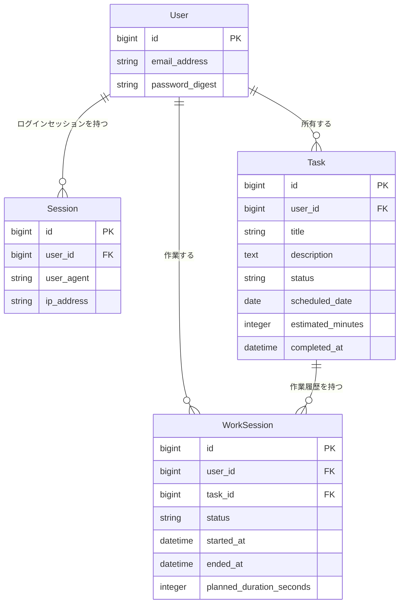

# DoNow

DoNowは、「やるべきことは分かっているのに、なかなか始められない」という課題に向き合う、先延ばし防止のためのWebアプリケーションです。

タスクを登録して終わりにするのではなく、実際に作業を始めた時刻と作業の区切りを記録します。まず5分だけ取り組むための集中タイマーも備え、心理的な負担を小さくしながら最初の一歩を後押しします。

## 解決したい課題

先延ばしの場面では、タスクの存在や締め切りを把握していても、「作業が大きく見える」「完璧に進めなければならない」と感じることで着手が難しくなることがあります。

DoNowは、完了数だけではなく「着手できたこと」も記録します。作業を小さく始め、途中で中断しても履歴を残せる設計にすることで、利用者が自分の行動を振り返りながら再開しやすくすることを目指しています。

## 通常のToDoアプリとの違い

一般的なToDoアプリがタスクの整理や完了管理を中心とするのに対し、DoNowは「いつ着手したか」「どのくらい作業したか」という実行過程を重視しています。

- タスクの完了だけでなく、開始・中断・スキップを状態として管理します。
- 作業を始めると`WorkSession`が作成され、開始時刻と終了時刻が記録されます。
- 5分集中タイマーにより、大きなタスクでも短い時間から取りかかれます。
- ページの再読み込みやブラウザの再起動後も、サーバー上の開始時刻を基準にタイマーを復元します。
- 同じユーザーが複数の作業セッションを同時に進行できないよう、アプリケーションとデータベースの両方で制御しています。

## 主な機能

### ユーザー認証

- ユーザー登録
- ログイン／ログアウト
- パスワード再設定
- 未ログインユーザーの保護対象画面へのアクセス制限

### ユーザーごとのタスク管理

- タスクの作成・閲覧・編集・削除
- 予定日、説明、見積時間の登録
- 他のユーザーが所有するタスクや作業セッションへのアクセス防止

### タスクの状態管理

タスクは次の状態を持ちます。

| 状態 | 説明 |
| --- | --- |
| `pending` | 未着手、または中断後の状態 |
| `active` | 作業中 |
| `completed` | 完了 |
| `skipped` | 今回は取り組まないと判断した状態 |

開始・中断・完了・スキップの操作に合わせて、関連する`WorkSession`も更新されます。

### WorkSessionによる着手記録

タスクを開始すると`WorkSession`を作成し、`started_at`を記録します。完了または中断時には`ended_at`とセッションの状態を更新するため、タスクの結果だけでなく作業の経過も履歴として残せます。

同一ユーザーが複数の未終了セッションを持たないよう、モデルのバリデーション、行ロック、PostgreSQLの部分ユニークインデックスを組み合わせています。

### 5分集中タイマー

- ダッシュボードの各未完了タスクから1回の操作で5分タイマーを開始
- タイトルだけのクイックスタートで、今日のタスク作成とタイマー開始を同時に実行
- 「前回の続き」から直近に着手した未完了タスクを再開
- タイマー開始と同時にタスクを`active`へ変更し、`WorkSession`を作成
- 目標に紐づく未来カードは、開始を妨げずタイマー画面内に表示
- 任意の「この5分でやらないこと」を選び、タイマー画面に常時表示
- `5:00`から`0:00`までカウントダウン
- `started_at`とサーバーに保存した予定時間から残り時間を復元
- ページの再読み込みやブラウザを閉じた後も、進行中のセッションを再表示
- 終了後に「完了」「5分延長」「10分延長」「中断」から次の行動を選択
- 延長した時間をサーバー側へ保存

フロントエンドにはRails標準構成のStimulusを使用し、Reactやタイマー用の外部ライブラリは導入していません。

### ダッシュボードと履歴

- 当日のタスク一覧
- 完了・未完了・着手済み件数の表示
- 日付ごとのタスク履歴
- WorkSessionの開始時刻、終了時刻、作業時間、状態の表示

## 技術構成

| 分類 | 技術 |
| --- | --- |
| バックエンド | Ruby 3.4.10 / Ruby on Rails 8.1.3 |
| データベース | PostgreSQL |
| フロントエンド | Hotwire（Turbo / Stimulus）、Importmap |
| CSS | Rails Asset Pipeline（Propshaft）/ 独自CSS |
| 認証 | Rails標準の認証構成、`has_secure_password` |
| テスト | RSpec / Capybara |

## モデル関連



- `User`は複数の`Task`とログイン用の`Session`を持ちます。
- `Task`は1人のユーザーに属し、複数の`WorkSession`を持ちます。
- `WorkSession`はタスクとユーザーの両方に属し、作業時間と集中タイマーの予定時間を保持します。
- タスクを削除すると、関連する`WorkSession`も削除されます。

## ローカル環境のセットアップ

### 必要な環境

- Ruby 3.4.10
- Bundler
- PostgreSQL
- Git

PostgreSQLを起動し、現在のOSユーザーでデータベースを作成できる状態にしてください。接続情報を変更する場合は、`config/database.yml`または環境変数を利用します。

### セットアップ手順

```bash
git clone <repository-url>
cd donow
bin/setup --skip-server
```

`bin/setup`はGemのインストール確認、データベースの作成・マイグレーション、ログと一時ファイルの整理を行います。

セットアップ完了後、開発サーバーを起動します。

```bash
bin/dev
```

ブラウザで [http://localhost:3000](http://localhost:3000) を開いてください。

個別にセットアップする場合は、次のコマンドでも準備できます。

```bash
bundle install
bin/rails db:prepare
bin/dev
```

## テスト

RSpecの全テストを実行します。

```bash
bundle exec rspec
```

特定のテストだけを実行する例:

```bash
bundle exec rspec spec/requests/focus_spec.rb
bundle exec rspec spec/models/work_session_spec.rb
```

認証、タスクの状態遷移、集中タイマーの開始・復元・延長・完了・中断、ユーザー間のアクセス制御、複数activeセッションの防止をテストしています。

## 今後の改善予定

以下は今後の検討項目であり、現在は未実装です。

- タスクの期限や集中開始時刻に合わせた通知機能
- 週・月単位の着手回数や集中時間の可視化
- タグ、優先度、検索によるタスク整理
- 集中時間をユーザーが任意に設定できる機能
- PWA対応とオフライン時の操作改善
- アクセシビリティとキーボード操作の継続的な改善

## 開発方針

DoNowでは機能を増やすことだけでなく、タスクや作業セッションの所有権、同時実行時の整合性、ページ再読み込み後の状態復元といった、実際の利用時に起こる問題を考慮して実装しています。Railsの標準機能を中心に、構成を必要以上に複雑にせず、テストで振る舞いを確認できる設計を目指しています。
